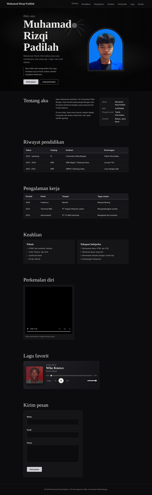

# UTS Pemrograman Web: Profil Pribadi

- **Nama / NIM:** Muhamad Rizqi Padilah / 312510080
- **Mata kuliah:** Pemrograman Web (Teknik Informatika, Universitas Pelita Bangsa)
- **Dosen:** Sufajar Butsianto, S.Kom, M.Kom

## Ringkasan proses
1. Merancang struktur halaman dengan semantic HTML5 (`header`, `nav`, `main`, `section`, `article`, `aside`, `figure`, `footer`).
2. Membuat hero, biografi, dua tabel (pendidikan dan pengalaman), daftar keahlian (`ul` dan `ol`), serta multimedia (`video` dan `audio`).
3. Menata tampilan di `style.css`: CSS variables, Flexbox, Grid, dan media query agar responsif.
4. Membuat form kontak dengan validasi JavaScript (nama, email, pesan) beserta pesan error dan sukses.
5. Menguji di desktop dan mobile.

## Screenshot hasil

### Tampilan desktop

### Tampilan mobile

